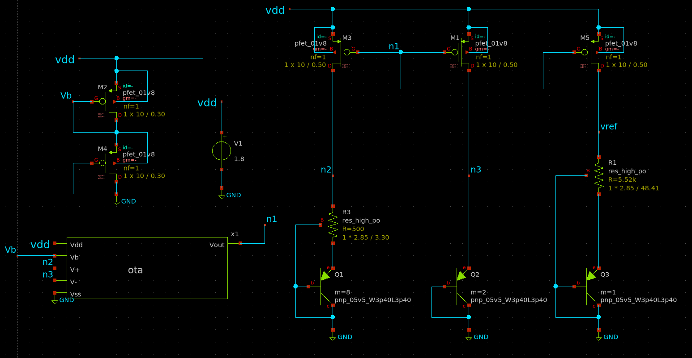
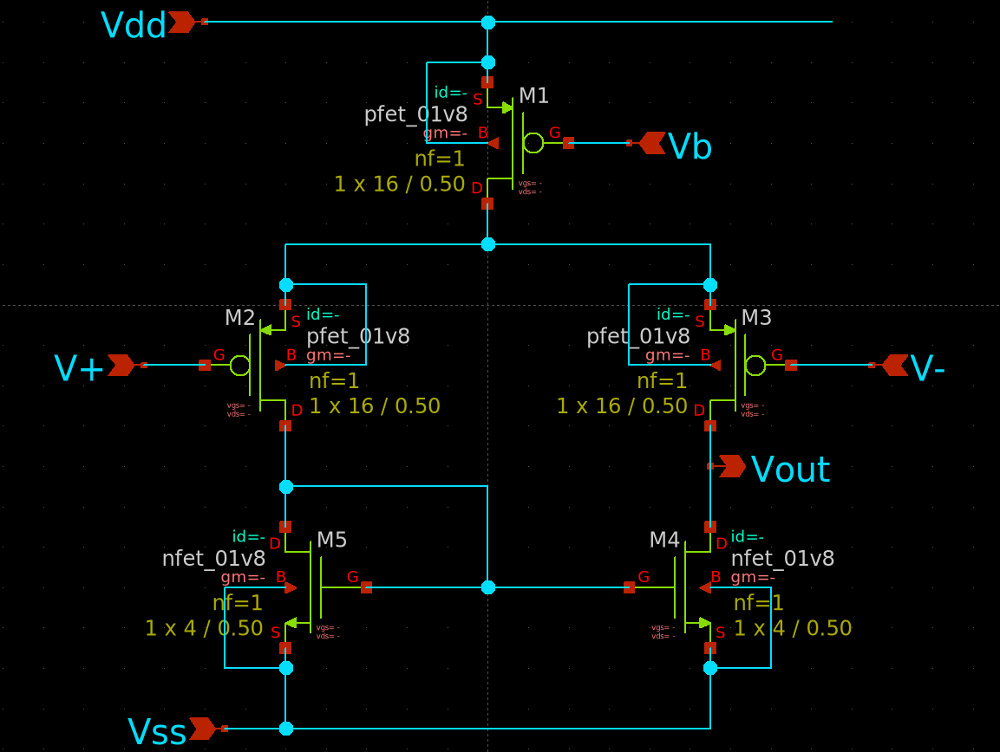
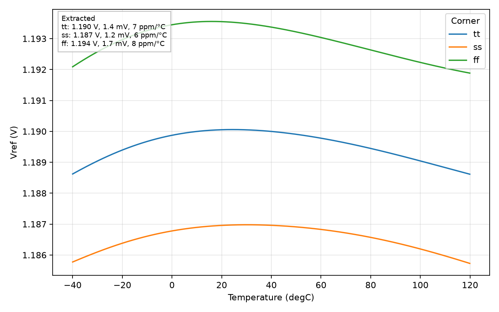
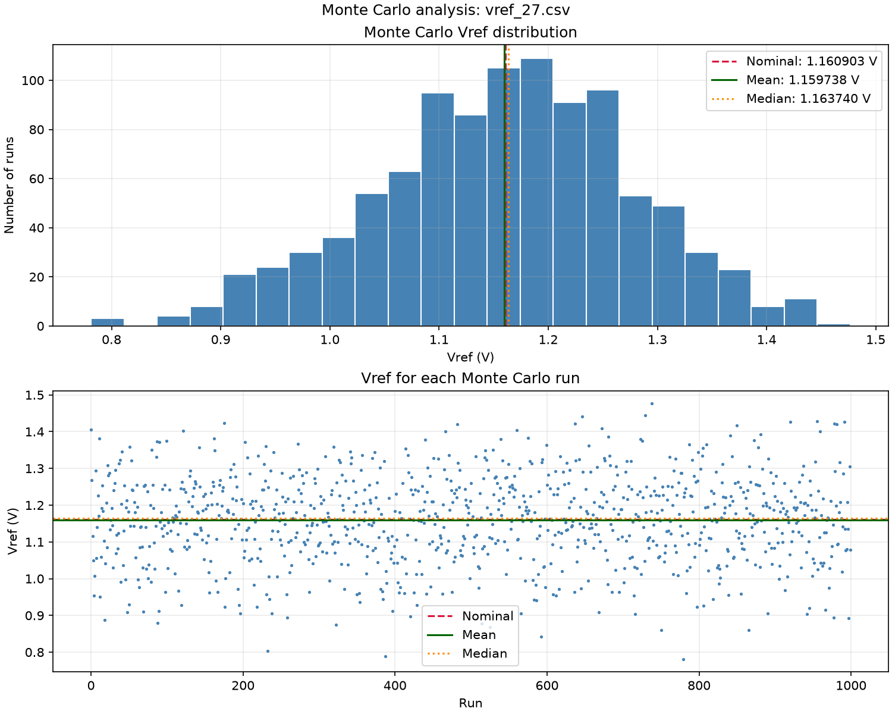

# SKY130 Bandgap Reference

This repository contains the Xschem schematics, device-level investigations,
and simulation results for a low-voltage bandgap reference using the SKY130
process design kit.

The project is developed around an Xschem-first workflow. Xschem schematics
are the source of truth; ngspice is used as the simulator through the
schematic simulation setup and generated netlists.

## Project status

- Target supply: 1.8 V
- Process: SKY130A
- Schematic editor: Xschem
- Simulator: ngspice 47 or newer
- Main circuit: bandgap reference with a two-stage amplifier

The circuit is an experimental design and is not yet characterized as a
production-ready reference. Startup, loop stability, PSRR, line regulation,
and load regulation may still require additional work.

## Requirements

Install the following tools and make the SKY130A PDK available locally:

- Xschem
- ngspice 47+
- SKY130A PDK
- Python 3 for optional result-processing scripts

Set `PDK_ROOT` to the directory containing the PDK checkout. The exact model
and symbol paths are defined by the Xschem and simulation configuration used
by the schematics.

```sh
export PDK_ROOT=/path/to/your/pdk
```

## Repository structure

```text
.
├── Bandgap/
│   ├── Bandgap.sch          # Main bandgap schematic
│   ├── ota.sch              # OTA schematic used by the bandgap
│   ├── ota.sym              # Local Xschem symbol for the OTA
│   ├── Monte_Carlo/         # Monte Carlo netlist, data, and analysis script
│   ├── Result/               # Simulation netlists and generated data
│   ├── Schem_Res/            # Rendered schematics and plots
│   └── plot_raw.py           # Optional raw-data plotting script
├── Bjt/
│   ├── pnp.spice            # PNP device investigation
│   └── vbe.txt              # Recorded VBE data
├── Mos_Analysis/
│   ├── NmosVth/              # NMOS threshold-voltage analysis
│   ├── PmosId/               # PMOS operating-point analysis
│   └── PmosVth/              # PMOS threshold-voltage analysis
└── readme.md
```

## Xschem workflow

1. Open `Bandgap/Bandgap.sch` or `Bandgap/ota.sch` in Xschem.
2. Check the device models, supply values, transistor dimensions, and wiring
	before running a simulation.
3. Run the simulation from Xschem using the schematic's configured ngspice
	simulation command.
4. Inspect waveforms and operating points in the Xschem/ngspice plot window.
5. Save rendered schematics and exported plots under `Bandgap/Schem_Res/`.
6. Keep generated raw data and netlists under `Bandgap/Result/` rather than
	editing generated files as the primary circuit source.

The standalone files under `Bjt/` and `Mos_Analysis/` are supporting device
studies. They are useful for checking the temperature behavior and operating
regions used when sizing the main schematic.

## Main schematics

### Bandgap reference

`Bandgap/Bandgap.sch` contains the main bandgap reference and its configured
simulation plots.



### OTA

`Bandgap/ota.sch` contains the OTA used in the current bandgap design.



## Results

Rendered schematics and simulation plots are stored in
`Bandgap/Schem_Res/`. The current repository includes the bandgap and OTA
schematics, process-corner results, and Monte Carlo results.

## Bandgap design evolution

This project evolved through the following stages:

1. **[Old-Bandgap branch](https://github.com/iamanoob12/Bandgap/tree/Old-Bandgap)** -
   an initial compact ngspice experiment using an ideal voltage-controlled
   op-amp, SKY130 PNPs, PFETs, and a simple resistor network. It established
   the basic bandgap behavior, with a simulated output of approximately
   1.20--1.25 V over temperature, but did not yet model a realistic amplifier
   or fully characterize the reference.
2. **[V1 branch](https://github.com/iamanoob12/Bandgap/tree/V1)** - the
   design was moved toward an Xschem-first implementation with the
   two-stage amplifier and SKY130 device models. This branch is currently at
   the same revision as `main`.
3. **[V2 branch](https://github.com/iamanoob12/Bandgap/tree/V2)** - the
   improved implementation uses a real two-stage OTA in the feedback loop,
   SKY130 high-poly resistors, process-corner temperature sweeps, and Monte
   Carlo analysis. The typical-corner result is approximately 1.161 V at
   27 °C, with 4--6 ppm/°C temperature coefficient across the process
   corners.

Simulation data in `Bandgap/Result/` may be regenerated when the schematic or
simulation setup changes. The plotting helper can be used to process ngspice
raw files when a Python environment with its dependencies is available:

```sh
.venv/bin/python Bandgap/plot_raw.py
```

This also writes `Bandgap/Schem_Res/corner_result.txt`, containing the
extracted corner values and measured shift from TT at 27 °C. The generated
corner plot annotation also uses the Vref, temperature variation, and
temperature coefficient extracted from the raw files.

## Vref versus temperature and process corner

Setup: 1.8 V supply, −40 °C to 125 °C, `tt` / `ss` / `ff` model corners, OTA in the loop.

| Corner | Vref @ 27 °C | Vref min | Vref max | Peak-to-peak | TC (ppm/°C) | Shift vs. tt @ 27 °C |
| ------ | ------------ | -------- | -------- | ------------ | ----------- | -------------------- |
| tt     | ≈ 1.1609 V   | ≈ 1.1599 V (-40 °C) | ≈ 1.1609 V (16.6 °C)  | ≈ 1.0 mV | ≈ 5 | n/a |
| ss     | ≈ 1.1547 V   | ≈ 1.1535 V (119.9 °C) | ≈ 1.1547 V (36.3 °C)  | ≈ 1.2 mV | ≈ 6 | ≈ -6 mV (-0.5 %) |
| ff     | ≈ 1.1672 V   | ≈ 1.1667 V (-40 °C) | ≈ 1.1674 V (-2.2 °C)  | ≈ 0.7 mV | ≈ 4 | ≈ +6 mV (+0.5 %) |

Temperature coefficient is the box method: TC = (Vmax − Vmin) / (Vref(27 °C) · 165 °C) · 10⁶.

Notes:
- The TT result is ≈ 1.161 V, which is in the expected range for a conventional silicon bandgap reference.
- tt has the lowest variation (≈ 5 ppm/°C), consistent with the design having been tuned at tt.
- The corner-to-corner spread at 27 °C (ss to ff ≈ 12.5 mV, ≈ 1.1 %) is larger than the temperature variation inside any one corner.
- All three corners remain close to the 1.16 V nominal target; process corners shift the output by about ±6 mV.
- The resistors are ideal (not SKY130 resistor models), so the corner spread covers only what the model corners change. There is no resistor spread and no mismatch (Monte Carlo) here.
- Values above are extracted from the raw data and can be regenerated with the plotting helper.



## Monte Carlo variation

The Monte Carlo analysis contains 1,000 samples of `Vref` at 27 °C. The
nominal value is taken from the TT raw-data result:

| Metric | Result |
| ------ | ------ |
| Nominal | 1.160903 V |
| Mean | 1.159738 V |
| Median | 1.163740 V |
| Sample sigma | 0.117148 V (10.091 %) |
| 3-sigma range | 0.809461 V to 1.512346 V |
| Observed minimum / maximum | 0.781199 V to 1.476690 V |

The 3-sigma range is calculated as `nominal ± 3 × sample sigma`. The large
Monte Carlo spread indicates that the mismatch model or circuit operating
point should be investigated separately from the process-corner result.

The distribution and run-by-run results are plotted from
`Bandgap/Monte_Carlo/vref_27.csv` by
`Bandgap/Monte_Carlo/analyze_vref.py`:



The full generated report is available in
[`Bandgap/Schem_Res/vref_statistics.txt`](Bandgap/Schem_Res/vref_statistics.txt).

## Topology evolution

The first design attempt used a diode-connected PMOS and diode-connected NMOS
stacked directly in series with the PNP sensing device (the classic Brokaw-style
PTAT stack). Checking the minimum voltage this stack requires, using
SKY130's threshold voltages at 27 °C — $|V_{thp}|=0.95V$, $V_{thn}=0.7V$,
and $V_{BE}\approx0.7V$ — gives:

$$V_{DD} \geq |V_{thp}| + V_{thn} + V_{BE} = 0.95 + 0.7 + 0.7 = 2.35V$$

This exceeds the 1.8 V supply even at zero overdrive voltage on both
transistors, before any margin is added for saturation or process/temperature
variation. Since diode-connected devices force $V_{GS}=V_{th}+V_{ov}$ with no
freedom to reduce $V_{ov}$ below zero, no amount of device sizing can close
this gap — the stacked diode-connected topology is structurally infeasible at
1.8 V in this process, and a different topology was required.

The design was reworked to remove the diode-connected NMOS from the PTAT
branch entirely. A single PMOS current source per branch, with an op-amp
forcing the two branch drain voltages to match, replaces the second
diode-connected device and its associated headroom cost. This keeps the
series-stacked device count in each sensing branch to one PMOS plus one BJT,
which fits inside the 1.8 V supply with real margin.

## Earlier V1 PMOS sizing analysis

Device sizing was checked at the worst case for threshold-voltage headroom:
the `tt` corner at -40 °C, where $|V_{thp}|$ rises to approximately 1.03 V.
Using $\Delta V_{BE}=\frac{kT}{q}\ln(8)$ (an 8:1 PNP emitter-area ratio) with
the earlier $R_1=1k\Omega$ value, the PTAT branch current at -40 °C works out
to approximately 40–50 µA. This is a V1 sizing reference; V2 uses
$R_1=500\ \Omega$ as described below.

At $W=1, L=0.5$ and biased for this worst-case current, the PMOS carries
$6.394588\times10^{-5}A$ at the edge of the saturation region — i.e., at
-40 °C the PMOS sits right at the triode/saturation boundary rather than
comfortably inside saturation. As temperature rises, $|V_{thp}|$ decreases,
increasing the available overdrive and moving the device further into
saturation, so -40 °C is the binding constraint for this sizing.

## V2 topology and design rationale

The current design is a revision of the V1 topology described above. V2 uses
an 8:1 PNP emitter-area ratio in the PTAT core, implemented with a PNP
multiplier of $m=8$. This forms the two-PTAT structure used by the feedback
loop: the difference in $V_{BE}$ is generated by the area ratio and converted
to a PTAT current through $R_1$.

The V2 value of $R_1=500\ \Omega$ is half the value used in the
Old-Bandgap design. This lower resistance is intentional. It increases the
PTAT current produced by the $\Delta V_{BE}$ term and allows the PMOS load
above the PNP devices to operate closer to the weak-inversion/strong-inversion
transition, rather than being limited by the low-current operating point of
the earlier design. The PMOS operating region and its margin should still be
checked across process, temperature, and supply corners.

The CTAT branch is different from the PTAT core: it uses a single PNP rather
than the 8:1 PNP pair. Its temperature dependence is therefore obtained from
the $dV_{BE}/dT$ extracted from the BJT SPICE run, approximately
$-1.25$ to $-1.4\ \mathrm{mV}/^\circ\mathrm{C}$ over the observed range.
The OTA combines this single-PNP CTAT voltage with the PTAT contribution to
set the Vref temperature coefficient.

This V2 arrangement replaces the V1 sizing trade-offs based on reducing
channel length and increasing $R_{BE}$. It keeps the PNP area scaling and
resistor value explicit in the schematic while using the OTA to enforce the
required branch-voltage relationship.

## Future work

- Verify the effect of channel-length reduction and short-channel effects on
	$V_{th}$, output resistance, and operating-region margins.
- Analyze PSRR and determine how the PMOS load dimensions affect it.
- Check loop stability, compensation, startup, line regulation, and load
	regulation.
