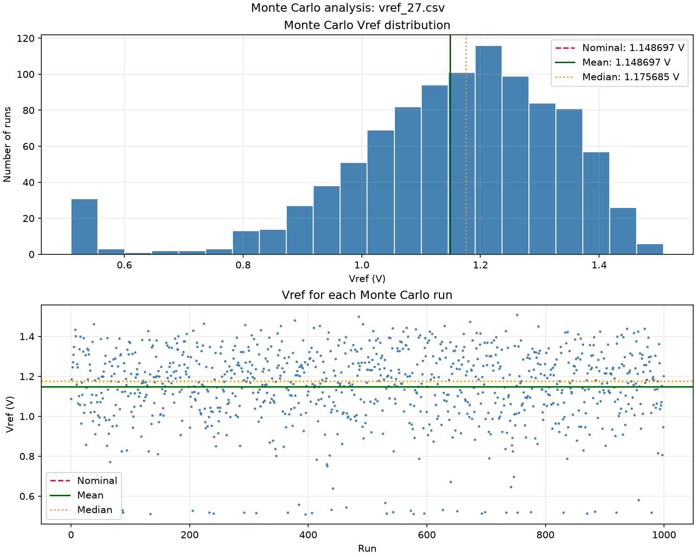

# SKY130 Bandgap Reference

This repository contains the Xschem schematics, device-level investigations,
and simulation results for a low-voltage bandgap reference using the SKY130
process design kit.

The project is developed around an Xschem-first workflow. Xschem schematics
are the source of truth; ngspice is used as the simulator through the
schematic simulation setup and generated netlists.

## Project status

- Target supply: 1.8 V
- Process: SKY130A
- Schematic editor: Xschem
- Simulator: ngspice 47 or newer
- Main circuit: bandgap reference with a two-stage amplifier

The circuit is an experimental design and is not yet characterized as a
production-ready reference. Startup, loop stability, PSRR, line regulation,
and load regulation may still require additional work.

## Requirements

Install the following tools and make the SKY130A PDK available locally:

- Xschem
- ngspice 47+
- SKY130A PDK
- Python 3 for optional result-processing scripts

Set `PDK_ROOT` to the directory containing the PDK checkout. The exact model
and symbol paths are defined by the Xschem and simulation configuration used
by the schematics.

```sh
export PDK_ROOT=/path/to/your/pdk
```

## Repository structure

```text
.
├── Bandgap/
│   ├── Bandgap.sch          # Main bandgap schematic
│   ├── ota.sch              # OTA schematic used by the bandgap
│   ├── ota.sym              # Local Xschem symbol for the OTA
│   ├── Monte_Carlo/         # Monte Carlo netlist, data, and analysis script
│   ├── Result/               # Simulation netlists and generated data
│   ├── Schem_Res/            # Rendered schematics and plots
│   └── plot_raw.py           # Optional raw-data plotting script
├── Bjt/
│   ├── pnp.spice            # PNP device investigation
│   └── vbe.txt              # Recorded VBE data
├── Mos_Analysis/
│   ├── NmosVth/              # NMOS threshold-voltage analysis
│   ├── PmosId/               # PMOS operating-point analysis
│   └── PmosVth/              # PMOS threshold-voltage analysis
└── readme.md
```

## Xschem workflow

1. Open `Bandgap/Bandgap.sch` or `Bandgap/ota.sch` in Xschem.
2. Check the device models, supply values, transistor dimensions, and wiring
	before running a simulation.
3. Run the simulation from Xschem using the schematic's configured ngspice
	simulation command.
4. Inspect waveforms and operating points in the Xschem/ngspice plot window.
5. Save rendered schematics and exported plots under `Bandgap/Schem_Res/`.
6. Keep generated raw data and netlists under `Bandgap/Result/` rather than
	editing generated files as the primary circuit source.

The standalone files under `Bjt/` and `Mos_Analysis/` are supporting device
studies. They are useful for checking the temperature behavior and operating
regions used when sizing the main schematic.

## Main schematics

### Bandgap reference

`Bandgap/Bandgap.sch` contains the main bandgap reference and its configured
simulation plots.


### OTA

`Bandgap/ota.sch` contains the OTA used in the current bandgap design.


## Results

Rendered schematics and simulation plots are stored in
`Bandgap/Schem_Res/`. The current repository includes the bandgap and OTA
schematics, process-corner results, and Monte Carlo results.

## Bandgap design evolution

This project evolved through the following stages:

1. **[Old-Bandgap branch](https://github.com/iamanoob12/Bandgap/tree/Old-Bandgap)** -
   an initial compact ngspice experiment using an ideal voltage-controlled
   op-amp and ideal resistor network together with SKY130 PNPs and PFETs. It
   established the basic bandgap behavior, with a simulated output of
   approximately 1.20--1.25 V over temperature, but did not yet model a
   realistic amplifier or fully characterize the reference.
2. **[V1 branch](https://github.com/iamanoob12/Bandgap/tree/V1)** - the
   design was moved toward an Xschem-first implementation with the
   two-stage amplifier, SKY130 device models, and a generic poly (PO)
   resistor model. V1 is the NMOS-input OTA baseline used for the first
   non-ideal implementation.
3. **[V2 branch](https://github.com/iamanoob12/Bandgap/tree/V2)** - the
   improved implementation uses a real two-stage OTA in the feedback loop,
   SKY130 high-poly (`res_high_po`) resistors, process-corner temperature
   sweeps, and Monte Carlo analysis. The typical-corner result is
   approximately 1.161 V at 27 °C, with 4--6 ppm/°C temperature coefficient
   across the process corners.
4. **[V3 branch](https://github.com/iamanoob12/Bandgap/tree/V3)** - keeps the
   same bandgap topology and design concept as V2, while increasing the
   transistor sizes in the OTA and Vbias-generation circuitry. The larger
   devices are intended to reduce the OTA overdrive voltage ($V_{ov}$) and
   improve the available operating margin. Like V2, V3 uses SKY130
   high-poly (`res_high_po`) resistors. The current V3 typical-corner result
   is approximately 1.190 V at 27 °C, with 6--8 ppm/°C temperature
   coefficient across the process corners.

Simulation data in `Bandgap/Result/` may be regenerated when the schematic or
simulation setup changes. The plotting helper can be used to process ngspice
raw files when a Python environment with its dependencies is available:

```sh
.venv/bin/python Bandgap/plot_raw.py
```

This also writes `Bandgap/Schem_Res/corner_result.txt`, containing the
extracted corner values and measured shift from TT at 27 °C. The generated
corner plot annotation also uses the Vref, temperature variation, and
temperature coefficient extracted from the raw files.

## Vref versus temperature and process corner

Setup: 1.8 V supply, −40 °C to 125 °C, and the OTA in the loop. The process
corners are:

- `tt`: typical process models, used for the nominal baseline.
- `ss`: slow NMOS and slow PMOS process models.
- `ff`: fast NMOS and fast PMOS process models.
- `tt_mm`: typical process models with mismatch enabled, used by the Monte
  Carlo runs.

The `tt`, `ss`, and `ff` corner sweeps characterize process and temperature
variation without the Monte Carlo mismatch run. The `tt_mm` model is a
separate typical-corner model selection for mismatch analysis; it is not an
additional process corner.

| Corner | Vref @ 27 °C | Vref min | Vref max | Peak-to-peak | TC (ppm/°C) | Shift vs. tt @ 27 °C |
| ------ | ------------ | -------- | -------- | ------------ | ----------- | -------------------- |
| tt     | ≈ 1.1901 V   | ≈ 1.1886 V (119.9 °C) | ≈ 1.1901 V (24.4 °C)  | ≈ 1.4 mV | ≈ 7 | n/a |
| ss     | ≈ 1.1870 V   | ≈ 1.1857 V (119.9 °C) | ≈ 1.1870 V (30.2 °C)  | ≈ 1.2 mV | ≈ 6 | ≈ -3 mV (-0.3 %) |
| ff     | ≈ 1.1935 V   | ≈ 1.1919 V (119.9 °C) | ≈ 1.1936 V (16 °C)  | ≈ 1.7 mV | ≈ 8 | ≈ +3 mV (+0.3 %) |

Temperature coefficient is the box method: TC = (Vmax − Vmin) / (Vref(27 °C) · 165 °C) · 10⁶.

Notes:
- The TT result is ≈ 1.190 V, with the V3 sizing changes shifting the nominal
  output relative to the earlier V2 result.
- The temperature coefficient ranges from approximately 6 to 8 ppm/°C across
  the three process corners.
- The corner-to-corner spread at 27 °C (ss to ff ≈ 6.5 mV, ≈ 0.55 %) is
  smaller than the earlier V2 spread.
- All three corners remain close to the 1.19 V nominal target; process corners
  shift the output by about -3.1 mV to +3.5 mV.
- The current V3 schematic uses SKY130 `res_high_po` resistor models, so the
  corner spread includes the resistor model's corner behavior. This result
  table does not include resistor mismatch; mismatch is evaluated separately
  by the Monte Carlo analysis.
- Values above are extracted from the raw data and can be regenerated with the plotting helper.


## Monte Carlo variation

### Setup

The Monte Carlo run uses the SKY130 `tt_mm` model from
`sky130.lib.spice`, with a 1.8 V supply and an operating temperature of
27 °C. The control block performs 1,000 operating-point runs, resetting the
circuit before each run and writing the resulting `Vref` value to
`Bandgap/Monte_Carlo/vref_27.csv`. The `tt_mm` selection keeps the process at
the typical corner while enabling mismatch variation for `res_high_po`,
`res_generic_po`, and MOS devices. BJT mismatch is not enabled in this
analysis.

The nominal value reported below is taken from the separate TT raw-data
result, not from the Monte Carlo mean:

| Metric | Result |
| ------ | ------ |
| Nominal | 1.190056 V |
| Mean | 1.184496 V |
| Median | 1.183755 V |
| Sample sigma | 0.063974 V (5.376 %) |
| 3-sigma range | 0.998133 V to 1.381979 V |
| Observed minimum / maximum | 0.847041 V to 1.392410 V |

The 3-sigma range is calculated as `nominal ± 3 × sample sigma`. The large
Monte Carlo spread indicates that the mismatch model or circuit operating
point should be investigated separately from the process-corner result.

The distribution and run-by-run results are plotted from
`Bandgap/Monte_Carlo/vref_27.csv` by
`Bandgap/Monte_Carlo/analyze_vref.py`:


The full generated report is available in
[`Bandgap/Schem_Res/vref_statistics.txt`](Bandgap/Schem_Res/vref_statistics.txt).

### V1, V2, and V3 comparison

The same `tt_mm` Monte Carlo setup was also used to compare the three design
revisions:

| Revision | OTA input pair and sizing | Nominal Vref | Mean Vref | Median Vref | Sample sigma | Observed behavior |
| -------- | ------------------------- | ------------ | --------- | ----------- | ------------ | ----------------- |
| V1 | NMOS input pair; undersized for mismatch margin | 1.148697 V | 1.148697 V | 1.175685 V | n/a | Very wide, asymmetric spread with many failed low-output runs |
| V2 | PMOS input OTA with a larger PTAT mirror current; OTA still undersized | 1.160903 V | 1.159738 V | 1.163740 V | 0.117148 V (117.15 mV, 10.091%) | Centered distribution, but significant mismatch sensitivity remains |
| V3 | Larger OTA devices to further reduce $V_{ov}$ | 1.190056 V | 1.184496 V | 1.183755 V | 0.063974 V (63.974 mV, 5.376%) | Improved operating margin and mismatch behavior relative to V1 and V2 |

V1's poor Monte Carlo behavior is caused by the two-stage OTA's NMOS input
pair. When mismatch separates the input devices, the input operating point can
be driven too low, causing failed Monte Carlo runs whose bandgap output is
approximately 0.5 V at 27 °C rather than the intended regulated value.

V2 replaces the NMOS-input OTA with a PMOS-input OTA and increases the PTAT
mirror current. This avoids the dominant V1 input-pair mismatch problem:
the PMOS and NMOS threshold voltages have different temperature behavior, and
the PMOS threshold magnitude decreases much more strongly with temperature
than the NMOS threshold voltage. However, the OTA sizing is still
insufficient: without mismatch, its initial overdrive voltage is only about
1--3 mV, leaving little margin for device variation.

V3 increases the OTA device sizes to further reduce the initial overdrive
voltage and improve the available operating margin. This is the sizing change
described in the V3 design rationale above; it is intended to make the loop
less sensitive to mismatch rather than change the bandgap topology.




## Topology evolution

The first design attempt used a diode-connected PMOS and diode-connected NMOS
stacked directly in series with the PNP sensing device (the classic Brokaw-style
PTAT stack). Checking the minimum voltage this stack requires, using
SKY130's threshold voltages at 27 °C — $|V_{thp}|=0.95V$, $V_{thn}=0.7V$,
and $V_{BE}\approx0.7V$ — gives:

$$V_{DD} \geq |V_{thp}| + V_{thn} + V_{BE} = 0.95 + 0.7 + 0.7 = 2.35V$$

This exceeds the 1.8 V supply even at zero overdrive voltage on both
transistors, before any margin is added for saturation or process/temperature
variation. Since diode-connected devices force $V_{GS}=V_{th}+V_{ov}$ with no
freedom to reduce $V_{ov}$ below zero, no amount of device sizing can close
this gap — the stacked diode-connected topology is structurally infeasible at
1.8 V in this process, and a different topology was required.

The design was reworked to remove the diode-connected NMOS from the PTAT
branch entirely. A single PMOS current source per branch, with an op-amp
forcing the two branch drain voltages to match, replaces the second
diode-connected device and its associated headroom cost. This keeps the
series-stacked device count in each sensing branch to one PMOS plus one BJT,
which fits inside the 1.8 V supply with real margin.

## Earlier V1 PMOS sizing analysis

Device sizing was checked at the worst case for threshold-voltage headroom:
the `tt` corner at -40 °C, where $|V_{thp}|$ rises to approximately 1.03 V.
Using $\Delta V_{BE}=\frac{kT}{q}\ln(8)$ (an 8:1 PNP emitter-area ratio) with
the earlier $R_1=1k\Omega$ value, the PTAT branch current at -40 °C works out
to approximately 40–50 µA. This is a V1 sizing reference; V2 uses
$R_1=500\ \Omega$ as described below.

At $W=1, L=0.5$ and biased for this worst-case current, the PMOS carries
$6.394588\times10^{-5}A$ at the edge of the saturation region — i.e., at
-40 °C the PMOS sits right at the triode/saturation boundary rather than
comfortably inside saturation. As temperature rises, $|V_{thp}|$ decreases,
increasing the available overdrive and moving the device further into
saturation, so -40 °C is the binding constraint for this sizing.

## V2 and V3 topology and sizing rationale

The V2 and V3 designs are revisions of the V1 topology described above. Both use an 8:2 PNP emitter-area ratio in the PTAT core, implemented with PNP
multipliers of $m=8$ and $m=2$. This PTAT structure uses the area-ratio
difference in $V_{BE}$ to generate
$\Delta V_{BE}=\frac{kT}{q}\ln(8/2)=\frac{kT}{q}\ln(4)$, which is converted
to a PTAT current through $R_1$. The 8:2 ratio, rather than the earlier 8:1
ratio, provides the required PTAT contribution while allowing the PMOS
current mirror to operate in saturation.

The V2 and V3 value of $R_1=500\ \Omega$ is half the value used in the
Old-Bandgap design. This lower resistance is intentional. It increases the
PTAT current produced by the $\Delta V_{BE}$ term and allows the PMOS load
above the PNP devices to operate closer to the weak-inversion/strong-inversion
transition, rather than being limited by the low-current operating point of
the earlier design. The PMOS operating region and its margin should still be
checked across process, temperature, and supply corners.

The CTAT branch is different from the PTAT core: it uses a single PNP rather
than the 8:2 PNP pair. Its temperature dependence is therefore obtained from
the $dV_{BE}/dT$ extracted from the BJT SPICE run, approximately
$-1.25$ to $-1.4\ \mathrm{mV}/^\circ\mathrm{C}$ over the observed range.
The OTA combines this single-PNP CTAT voltage with the PTAT contribution to
set the Vref temperature coefficient.

In V2, the PMOS devices were resized substantially larger and $R_1$ (also
referred to as $R_{BE}$ in the earlier design discussion) was reduced. These
changes increase the current in each branch and provide the drive required by
the larger PMOS devices. V3 keeps the same topology, PNP area scaling, and
resistor value, but increases the device sizes in the OTA and Vbias-generation
circuits. This sizing change targets a lower OTA $V_{ov}$; it does not change
the underlying V2/V3 bandgap concept or feedback relationship.

## Future work

- Analyze PSRR.
- Check loop stability, compensation, startup, line regulation, and load
	regulation.
