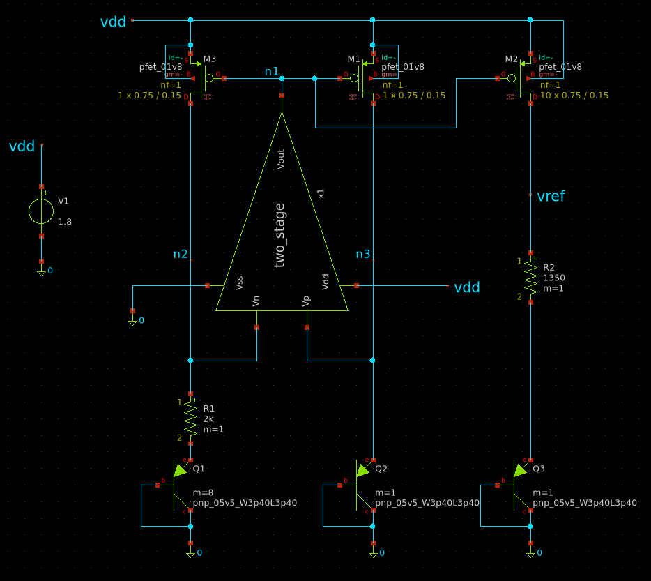
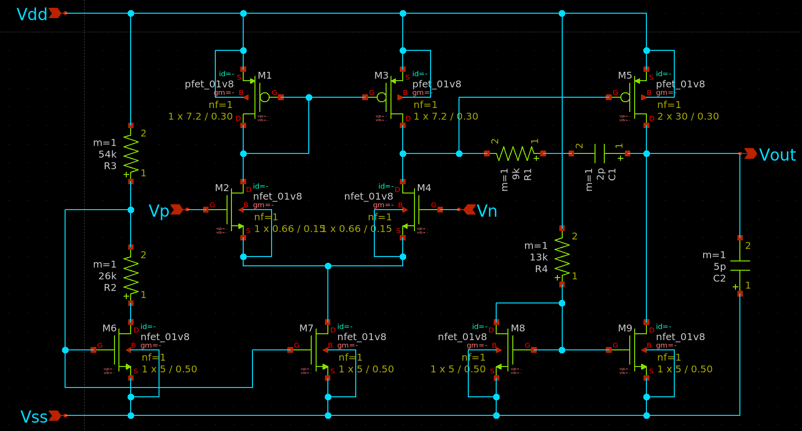

# SKY130 Bandgap Reference

This repository contains the Xschem schematics, device-level investigations,
and simulation results for a low-voltage bandgap reference using the SKY130
process design kit.

The project is developed around an Xschem-first workflow. Xschem schematics
are the source of truth; ngspice is used as the simulator through the
schematic simulation setup and generated netlists.

## Project status

- Target supply: 1.8 V
- Process: SKY130A
- Schematic editor: Xschem
- Simulator: ngspice 47 or newer
- Main circuit: bandgap reference with a two-stage amplifier

The circuit is an experimental design and is not yet characterized as a
production-ready reference. Startup, loop stability, PSRR, line regulation,
and load regulation may still require additional work.

## Requirements

Install the following tools and make the SKY130A PDK available locally:

- Xschem
- ngspice 47+
- SKY130A PDK
- Python 3 for optional result-processing scripts

Set `PDK_ROOT` to the directory containing the PDK checkout. The exact model
and symbol paths are defined by the Xschem and simulation configuration used
by the schematics.

```sh
export PDK_ROOT=/path/to/your/pdk
```

## Repository structure

```text
.
├── Bandgap/
│   ├── Bandgap.sch          # Main bandgap schematic
│   ├── two_stage.sch        # Two-stage amplifier schematic
│   ├── two_stage.sym        # Local Xschem symbol for the amplifier
│   ├── Result/               # Simulation netlists and generated data
│   ├── Schem_Res/            # Rendered schematics and plots
│   └── plot_raw.py           # Optional raw-data plotting script
├── Bjt/
│   ├── pnp.spice            # PNP device investigation
│   └── vbe.txt              # Recorded VBE data
├── Mos_Analysis/
│   ├── NmosVth/              # NMOS threshold-voltage analysis
│   ├── PmosId/               # PMOS operating-point analysis
│   └── PmosVth/              # PMOS threshold-voltage analysis
└── readme.md
```

## Xschem workflow

1. Open `Bandgap/Bandgap.sch` or `Bandgap/two_stage.sch` in Xschem.
2. Check the device models, supply values, transistor dimensions, and wiring
	before running a simulation.
3. Run the simulation from Xschem using the schematic's configured ngspice
	simulation command.
4. Inspect waveforms and operating points in the Xschem/ngspice plot window.
5. Save rendered schematics and exported plots under `Bandgap/Schem_Res/`.
6. Keep generated raw data and netlists under `Bandgap/Result/` rather than
	editing generated files as the primary circuit source.

The standalone files under `Bjt/` and `Mos_Analysis/` are supporting device
studies. They are useful for checking the temperature behavior and operating
regions used when sizing the main schematic.

## Main schematics

### Bandgap reference

`Bandgap/Bandgap.sch` contains the main bandgap reference and its configured
simulation plots.



### Two-stage amplifier

`Bandgap/two_stage.sch` contains the two-stage amplifier used in the current
design direction. Its rendered schematic is included here for reference:



## Results

Rendered schematics and simulation plots are stored in
`Bandgap/Schem_Res/`. The current repository includes the bandgap schematic,
the temperature-corner plot, and the two-stage amplifier schematic image.

Simulation data in `Bandgap/Result/` may be regenerated when the schematic or
simulation setup changes. The plotting helper can be used to process ngspice
raw files when a Python environment with its dependencies is available:

```sh
.venv/bin/python Bandgap/plot_raw.py
```


## Topology evolution

The first design attempt used a diode-connected PMOS and diode-connected NMOS
stacked directly in series with the PNP sensing device (the classic Brokaw-style
PTAT stack). Checking the minimum voltage this stack requires, using
SKY130's threshold voltages at 27 °C — $|V_{thp}|=0.95V$, $V_{thn}=0.7V$,
and $V_{BE}\approx0.7V$ — gives:

$$V_{DD} \geq |V_{thp}| + V_{thn} + V_{BE} = 0.95 + 0.7 + 0.7 = 2.35V$$

This exceeds the 1.8 V supply even at zero overdrive voltage on both
transistors, before any margin is added for saturation or process/temperature
variation. Since diode-connected devices force $V_{GS}=V_{th}+V_{ov}$ with no
freedom to reduce $V_{ov}$ below zero, no amount of device sizing can close
this gap — the stacked diode-connected topology is structurally infeasible at
1.8 V in this process, and a different topology was required.

The design was reworked to remove the diode-connected NMOS from the PTAT
branch entirely. A single PMOS current source per branch, with an op-amp
forcing the two branch drain voltages to match, replaces the second
diode-connected device and its associated headroom cost. This keeps the
series-stacked device count in each sensing branch to one PMOS plus one BJT,
which fits inside the 1.8 V supply with real margin.

## PMOS sizing at -40 °C

Device sizing was checked at the worst case for threshold-voltage headroom:
the `tt` corner at -40 °C, where $|V_{thp}|$ rises to approximately 1.03 V.
Using $\Delta V_{BE}=\frac{kT}{q}\ln(8)$ (an 8:1 PNP emitter-area ratio) with
$R_1=1k\Omega$, the PTAT branch current at -40 °C works out to approximately
40–50 µA.

At $W=1, L=0.5$ and biased for this worst-case current, the PMOS carries
$6.394588\times10^{-5}A$ at the edge of the saturation region — i.e., at
-40 °C the PMOS sits right at the triode/saturation boundary rather than
comfortably inside saturation. As temperature rises, $|V_{thp}|$ decreases,
increasing the available overdrive and moving the device further into
saturation, so -40 °C is the binding constraint for this sizing.

## CTAT / Vref branch sizing (old)

The CTAT (Vref-generating) branch reuses the same PTAT current through a
current mirror, but the mirrored branch was scaled to 10x the PTAT reference
current. This was done for two reasons: it reduces the required $R_2$ by the
same factor ($R_2\rightarrow R_2/10$ for the same voltage drop), keeping the
resistor value in a more practical range, and it reduces the relative impact
of $|V_{thp}|$ drift on the branch's operating point, since the larger bias
current keeps the mirror device further from the threshold-limited edge
identified above.

## Current topology and design rationale

While investigating the relationship between $R_{BE}$ and the PMOS load, I
observed the following:

1. Decreasing $R_{BE}$ increases $I_{PTAT}$. To support the higher current,
	 the PMOS width or multiplier must be increased, or the channel length must
	 be reduced. Reducing the channel length is expected to have a significant
	 effect on PSRR and therefore requires further analysis.
2. Reducing $L$ from 0.30 to 0.15 and increasing $R_{BE}$ from 1 kΩ to 2 kΩ
	 reduced $V_{th}$ and allowed the transistors to remain in saturation with a
	 slightly higher current. This is an initial observation that must be
	 verified with more detailed sweeps and corner analysis, including
	 short-channel effects.
3. Comparing the input and output of the ideal op amp showed that its behavior
	 matched the requirements of the two-stage OTA.

With these changes, the revised design operated as expected.

## Future work

- Replace the ideal op amp with the implemented two-stage OTA and verify the
	complete closed-loop bandgap operation.
- Sweep $R_{BE}$, PMOS width, multiplier, and channel length to quantify the
	current, headroom, and saturation trade-offs.
- Verify the effect of channel-length reduction and short-channel effects on
	$V_{th}$, output resistance, and operating-region margins.
- Analyze PSRR and determine how the PMOS load dimensions affect it.
- Check loop stability, compensation, startup, line regulation, and load
	regulation.
- Verify operation across process, supply-voltage, and temperature corners.
